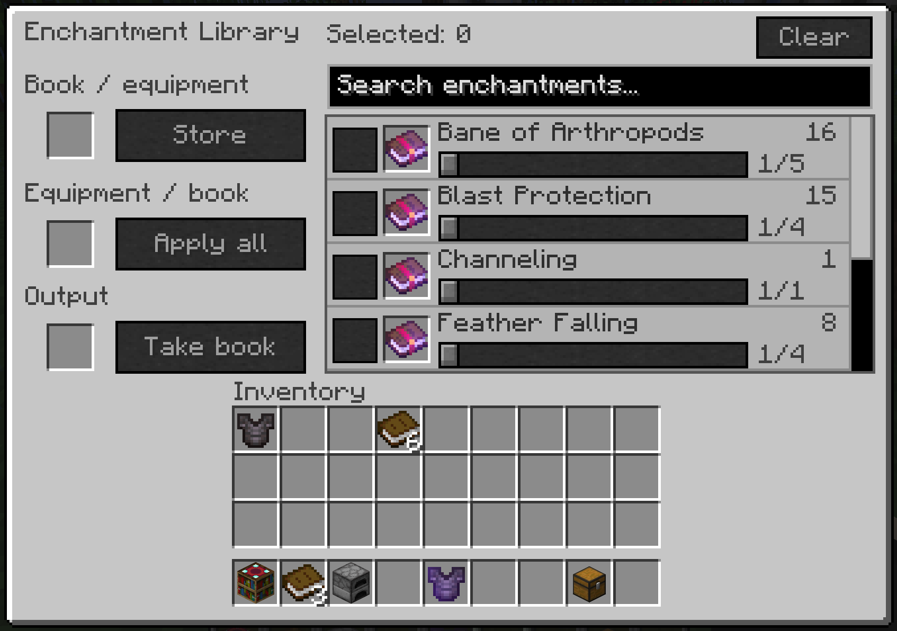

# Easy Enchantment Library


A searchable enchantment library with a vanilla-style interface. Store enchantments from books or equipment, split and combine their levels, then withdraw books or apply several enchantments at once.

[CurseForge](https://www.curseforge.com/minecraft/mc-mods/easy-enchantment-library) · [Issues](https://github.com/lingmu0/easy-enchantment-library/issues)

## Versions

| Minecraft | Loader | Java | Source branch |
| --- | --- | --- | --- |
| 1.20.1 | Forge 47.4.23+ | 17 | [mc-1.20.1](https://github.com/lingmu0/easy-enchantment-library/tree/mc-1.20.1) |
| 1.21.1 | NeoForge 21.1.233+ | 21 | [mc-1.21.1](https://github.com/lingmu0/easy-enchantment-library/tree/mc-1.21.1) |
| 26.1.2 | NeoForge 26.1.2.107+ | 25 | [mc-26.1.2](https://github.com/lingmu0/easy-enchantment-library/tree/mc-26.1.2) |

Install the matching JAR in `mods` on both the client and server. Just Enough Characters (JECh) is optional and only needed on the client for pinyin search. There are no other required mod dependencies. Replace an older JAR when updating; the mod ID remains `enchantment_library`.

## Using the library

Craft and place the library, then right-click it. The recipe uses two bookshelves, one gold ingot, five obsidian and one enchanting table:

```text
Bookshelf   Gold ingot       Bookshelf
Obsidian    Enchanting table Obsidian
Obsidian    Obsidian         Obsidian
```

- **Store:** Put an enchanted book or equipment in the top slot and click Store. Its stored enchantments, including curses, become library points. The output returns a plain book or the equipment with its enchantments removed, preserving durability, names and other item data.
- **Take books:** Put a plain book in the middle slot. Select one or more enchantments, set each row's level slider, then click Take book. All selected enchantments go into one book.
- **Enchant equipment:** Put equipment in the middle slot, select enchantments and levels, then click Apply all. Suitability, compatibility and available points are checked for the whole selection before anything is consumed. Successful equipment stays in the middle slot. Upgrades charge only the point difference; unchanged levels are free.
- **Split and combine:** Level I costs 1 point, II costs 2, III costs 4, IV costs 8 and V costs 16. A level V book can become sixteen level I books, and sixteen level I books can become a level V book. There is no level-unlock requirement.
- **Dynamic levels:** The library reads each enchantment's runtime `getMaxLevel()` rather than a hardcoded vanilla level table. Mods that change those limits through the game's enchantment API are respected. Equipment suitability and mutually exclusive enchantments still follow the game and loader APIs.
- **Search and select:** Search localized names or registry IDs using multiple terms. Selections and slider levels survive filtering and scrolling. Hover the selected count to inspect hidden selections, or use Clear to deselect everything.
- **Keep your collection:** Breaking and placing the library preserves stored points and slot contents. Points for temporarily absent enchantments remain stored by registry ID. Reducing a level limit does not delete existing points.

Each row has its own slider and checkbox. Dragging a slider selects the row; arrow keys adjust by one level, Shift adjusts by five, and Home/End select the endpoints. The frame, slots and widgets use vanilla assets, and book previews have normal Minecraft item tooltips.



The screenshot shows Minecraft 1.21.1. All versions use the same interface layout.

## Pinyin search

With the matching **Just Enough Characters (JECh)** version installed, search calls its `Match.contains(String, CharSequence)` API and follows JECh's pinyin, initials, double-pinyin and fuzzy settings. Without JECh, localized names and registry-ID searches work normally.

## Building

Check out the branch for your target Minecraft version and set `JAVA_HOME` to Java 17 for Forge 1.20.1, Java 21 for NeoForge 1.21.1, or Java 25 for NeoForge 26.1.2:

```powershell
.\gradlew.bat build
python .\tools\validate_artifact.py
```

Build output is in `build/libs`. Install the main JAR; `-sources.jar` is for development. Resources can be regenerated with `python tools/generate_resources.py`.

`build` includes 20,062 ledger checks, 27 batch-operation checks and JSON/NBT storage codec checks (including the 26.1.2 ValueInput/ValueOutput and previous block storage formats), without launching Minecraft. The artifact validator checks resources, translations, metadata, Java bytecode and client/server code isolation; Forge artifacts are also checked for reobfuscation. GUI behavior, multiplayer interaction and JECh integration still need in-game verification. Storage uses arbitrary-precision points with a 4096-bit serialization bound.

## 中文

附魔图书馆支持存取附魔书、提取装备附魔并返还无附魔装备，也可直接给装备批量附魔。每条附魔都有独立等级滑条和多选框，取书时可将全部选项写入同一本书。

I 级为 1 点，每升一级点数翻倍；高等级可拆成低等级，低等级可合成高等级。最高等级读取运行时附魔 API，兼容通过该 API 修改上限的模组；应用装备时仍检查适用范围和附魔互斥。安装对应版本的 JECh 后支持拼音搜索。拆除图书馆保留全部储量及槽位物品。

客户端和服务端均需安装对应版本，JECh 仅客户端可选。构建与自动检查已通过；界面、多人与拼音兼容仍待实机验证。

## License and artwork

Code: [MIT](LICENSE). The project icon was generated with OpenAI ImageGen; details and the exact prompt are in [docs/artwork.md](docs/artwork.md). Minecraft textures are referenced from the installed game and are not redistributed. This is an independent project inspired by the enchantment-library concept, with no dependency on Apotheosis.
